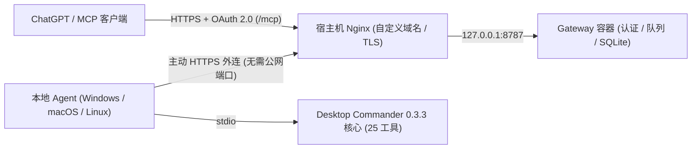

<div align="center">

# Remote.Command

**自建个人 Remote MCP 服务，让 ChatGPT 安全操控你的本地电脑**

[](https://nodejs.org/)
[](compose.yaml)
[](#快速开始)
[-blue)](vendor/desktop-commander-full/LICENSE)

[快速开始](#快速开始) · [审批与任务](#安全审批与后台任务) · [进阶用法](#进阶用法) · [工具列表](#工具能力一览) · [技术文档](#测试与参考文档)

</div>

---

## 架构与特性



- **零内网穿透**：本地 Agent 主动通过 HTTPS 外连 Gateway，目标电脑无需公网 IP 或开放入站端口。
- **双重安全边界**：支持 `read` / `write` / `exec` 细粒度能力白名单；写文件、改配置、执行命令、终止进程等敏感操作默认挂起，需在本地终端手动审批后方可执行。
- **完整工具生态**：复用 Desktop Commander 0.3.3 MIT 核心，提供 25 个文件/终端/搜索/PDF 工具与 2 个 MCP App 资源，无累计调用次数上限。
- **断点可恢复**：内置任务队列与 SQLite 持久化，支持长耗时任务后台查询与持久终端会话管理。

---

## 快速开始

### 第一步：部署 Gateway 服务端

在已安装 Docker Compose 和 Nginx 的 Linux 服务器上部署。将自定义域名解析到这台服务器，并为 Nginx 配置域名证书。公网客户端统一访问 HTTPS `443`。

1. 将 [compose.yaml](compose.yaml) 保存到服务器，在文件中设置 `PUBLIC_ORIGIN`、`OAUTH_CLIENT_ID`、`OAUTH_REDIRECT_URIS` 和 `volumes.source`。按 [运维指南](docs/production.md#1-首次部署) 准备数据目录。
2. 执行以下命令。Compose 按需拉取镜像，Gateway 在首次启动时将密钥保存在 `data/.oauth_client_secret` 和 `data/.owner_key`，重建容器时从同一目录读取。

```sh
docker compose up -d --wait
```

3. 在宿主机 Nginx 为域名配置证书并代理到 `127.0.0.1:8787`。配置示例见 [remote-command.conf](deploy/nginx/remote-command.conf)。用 `data/.owner_key` 中的密钥登录域名下的 `/manage`。

---

### 第二步：在目标电脑启动 Agent

> **前置条件**：目标电脑（Windows / macOS / Linux）已安装 **Node.js 24–26**。

从 [GitHub Releases](https://github.com/91270/Remote.Command/releases) 下载与 Gateway 同版本的 Agent 包，然后启动。

```sh
npx --yes --ignore-scripts --package=./remote-command-0.5.0.tgz remote-command remote
```

按交互提示完成配对：
1. **填写配置**：输入 Gateway 的 HTTPS 地址（如 `https://mcp.example.com`），选择允许访问的工作区目录与权限（直接回车默认当前目录 + 只读权限）。
2. **浏览器授权**：在自动打开的管理页核对设备名与配对码并批准（无桌面环境可追加 `--no-browser`，手动复制终端链接到其他设备打开）。
3. **完成连接**：在管理页确认设备已显示在线。默认配置是 `~/.remote-command/agent.json`，凭证位于 `~/.remote-command/device/identity.json`。后续运行同一命令会读取已保存的配置和凭证。

> [!TIP]
> 最小化 Debian 环境需安装 `procps`。使用 Markdown 转 PDF 功能需本机安装 Chrome 或 Chromium。

---

### 第三步：接入 ChatGPT 网页端

1. 在支持自定义 MCP 的 ChatGPT 账号或工作区中，添加 MCP Server URL：`https://mcp.example.com/mcp`（参考 [OpenAI 自定义 MCP 指南](https://developers.openai.com/api/docs/guides/custom-mcp-server)）。
2. 认证方式选择 **OAuth**，填入 Compose 中的 `OAUTH_CLIENT_ID` 和 `data/.oauth_client_secret` 中的密钥。
   - 若 ChatGPT 页面显示的回调地址与 Compose 默认值不同，将完整回调地址写入 `OAUTH_REDIRECT_URIS` 并执行以下命令。
     ```sh
     docker compose up -d --wait
     ```
3. 授权跳转到你的 Gateway 域名时，输入 `data/.owner_key` 中的密钥完成登录授权。
4. 在对话中先让 ChatGPT 调用 `list_devices` 查看设备，再通过 `select_device` 或工具参数 `device_id` 指定目标。只有一台设备在线时会自动选中。

---

## 安全审批与后台任务

### 本地人工审批（Human-in-the-Loop）

**写文件、修改配置、启动命令、终止进程、断开 Agent** 等敏感操作不会静默执行，而是会挂起并返回 `call_id`（**5 分钟内有效**），需在设备端终端查看参数并确认：

```sh
# 1. 查看待审批调用及完整参数
npx --yes --ignore-scripts --package=/path/to/remote-command-0.5.0.tgz remote-command agent approvals ~/.remote-command/agent.json

# 2. 批准或拒绝（将 PASTE_CALL_ID_HERE 替换为实际的 call_id）
npx --yes --ignore-scripts --package=/path/to/remote-command-0.5.0.tgz remote-command agent decide ~/.remote-command/agent.json PASTE_CALL_ID_HERE approve
# 拒绝则将 approve 改为 deny
```

> 若从源码目录运行，命令简化为 `node dist/agent.js approvals agent.local.json` 与 `node dist/agent.js decide agent.local.json <CALL_ID> approve`。

### 后台任务与持久终端

- **后台任务查询**：短耗时调用直接返回结果。异步调用可通过 `get_tool_result(call_id)` 查询结果，或通过 `cancel_tool_call(call_id)` 请求取消。`review_device_call` 可以预览尚未执行的工具和参数。
- **持久化终端会话**：`start_process` 返回的 PID 指向持续运行的终端会话，需使用 `read_process_output` 读取输出、使用 `force_terminate` 结束进程（取消 MCP 请求不会自动终止已启动的进程）。
- **容错与配额限制**：
  - Gateway 重启后仍可取回同一 Agent 进程内产生的结果；Agent 重启后，未结束的已派发任务会标记为 `interrupted`。
  - 每台设备最多 **4 个并发已派发任务**、**64 个排队任务**（排队项 15 分钟过期，结果保留 7 天）。
  - 已批准的命令以运行 Agent 的系统用户权限执行，工作区应由可信本地用户管理。

---

## 进阶用法

### Agent 启动参数

在 `remote-command remote` 后可附加以下参数：

| 参数 | 说明 |
| --- | --- |
| `--config <PATH>` | 指定自定义配置文件路径 |
| `--no-browser` | 不自动打开浏览器，仅在终端打印配对网址（适合无桌面/SSH 环境） |
| `--no-persist-session` | 创建临时会话，仅在内存保存凭证，正常退出时自动撤销临时设备 |
| `--disable-no-sleep` | 停用 macOS 运行期间的 `caffeinate` 防休眠 |
| `--debug` | 输出本地执行器恢复等调试日志 |
| `--logout` | 向 Gateway 撤销当前设备配对并清除本机凭证 |
| `--report` | 生成本地脱敏诊断 ZIP（含环境检查、连接与恢复事件） |
| `--help` | 显示完整命令行帮助 |

### 从源码运行与手动配置

如需定制配置或本地开发调试，可将 [agent.example.json](agent.example.json) 复制为 `agent.local.json` 并按需修改：

<details>
<summary>展开查看 agent.local.json 完整字段说明</summary>

| 字段 | 说明 |
| --- | --- |
| `gateway` | 自建 Gateway 的 HTTPS origin（如 `https://mcp.example.com`） |
| `workspace` | 允许访问的本地项目目录（绝对路径，Windows 可用 `C:/Users/you/workspace`） |
| `stateDir` | 该 Agent 的私有状态目录，须位于工作区之外（Unix 已有目录权限须为 `0700`） |
| `capabilities` | 本机允许的权限数组：`["read", "write", "exec"]`（默认只读） |
| `ripgrep` | 可选，本地 `rg` 绝对路径（省略时优先使用内置包，其次查找 `PATH`） |
| `chromePath` | 可选，本地 Chrome/Chromium 路径，供 Markdown 转 PDF 使用 |
| `noSleep` | 默认 `true`，macOS 上运行期间保持系统唤醒 |

</details>

**使用一键启动器**（自动检测 Node.js 24–26，缺失时按官方 SHA-256 校验下载便携版并完成编译启动）：

```sh
# macOS / Linux
./launch.sh agent.local.json
```

```powershell
# Windows PowerShell
.\launch.ps1 agent.local.json
```

**手动编译与客户端维护**（已安装 Node.js 24–26）：

```sh
npm ci --include=dev --ignore-scripts
npm run build

# 首次连接并配对（后续运行直接复用已保存身份）
node dist/agent.js connect agent.local.json

# 单独配对 / 仅启动已配对设备 / 使用管理后台 10 分钟邀请码配对
node dist/agent.js login agent.local.json
node dist/agent.js run agent.local.json
node dist/agent.js pair agent.local.json

# 查看状态 / 生成脱敏诊断包 / 注销设备
node dist/agent.js status agent.local.json
node dist/agent.js report agent.local.json
node dist/agent.js logout agent.local.json
```

> [!NOTE]
> 同一设备身份同时只能运行一个 Agent 实例。本地 MCP 子进程异常退出后会自动恢复，恢复期间设备显示离线，Gateway 会暂停向其派发任务。

### 服务端运维与备份

网页控制台 `/manage` 支持撤销设备、撤销 OAuth 授权和查看审计记录。同样可以在 Gateway 容器内调用管理命令。

```sh
# 查看设备列表 / 生成一次性配对邀请 / 撤销设备 / 撤销 OAuth / 查看审计日志
docker compose exec gateway node dist/admin.js devices
docker compose exec gateway node dist/admin.js pair laptop read,write,exec
docker compose exec gateway node dist/admin.js revoke <DEVICE_ID>
docker compose exec gateway node dist/admin.js oauth-revoke
docker compose exec gateway node dist/admin.js audit
```

在线备份和恢复步骤见 [运维指南](docs/production.md#6-在线备份与恢复演练)。

---

## 工具能力一览

| 类别 | 包含工具 |
| --- | --- |
| **文件读取** | `read_file`、`read_multiple_files`、`get_file_info`（支持文本、图片、URL、Excel、PDF、DOCX） |
| **文件与目录操作** | `write_file`、`create_directory`、`list_directory`、`move_file`、`edit_block`（含 Excel 单元格/范围与文档编辑） |
| **PDF 处理** | `write_pdf`（创建、修改与合并） |
| **终端与进程** | `start_process`、`interact_with_process`、`read_process_output`、`list_sessions`、`list_processes`、`kill_process`、`force_terminate` |
| **搜索会话** | `start_search`、`get_more_search_results`、`stop_search`、`list_searches` |
| **配置与统计** | `get_config`、`set_config_value`、`get_usage_stats`、`get_recent_tool_calls`、`give_feedback_to_desktop_commander` |
| **远程设备与任务** | `list_devices`、`select_device`、`who_am_i`、`get_tool_result`、`cancel_tool_call`、`list_remote_tool_calls`、`review_device_call`、`shutdown` |

- 原生文件工具遵循本机配置的 `allowedDirectories`（可在 `workspace` 内进一步缩小，不可越出工作区），并完整保留上游参数 schema（如负数 `offset`、`append`、`searchType`、`sheet/range` 等）。
- 文件预览与配置编辑通过 2 个 MCP App 资源提供，Gateway 透传 `content`、图片数据、`structuredContent` 与 `_meta`。

---

## 测试与参考文档

```sh
# 运行单元测试与端到端测试
npm test

# macOS / Linux 加测真实 TLS 和终端审批，需 OpenSSL 与 Python 3
RCM_TEST_TLS=1 RCM_TEST_TTY=1 npm test
```

| 文档 | 内容说明 |
| --- | --- |
| [架构说明](docs/architecture.md) | Gateway、Agent 与核心执行器的整体架构设计 |
| [离线部署与升级](docs/production.md) | 生产环境部署、镜像打包与升级步骤 |
| [客户端分析](docs/client-analysis.md) | 官方客户端配对与工具转发机制分析 |
| [官方架构核对](docs/official-architecture.md) | 传输实现与自建方案差异对比 |
| [验证记录](docs/verification.md) | 测试环境与完整验收结果记录 |
| [MIT 许可证](vendor/desktop-commander-full/LICENSE) / [修改说明](vendor/desktop-commander-full/NOTICE.md) | 复用的 Desktop Commander 核心许可与本地改动说明 |
