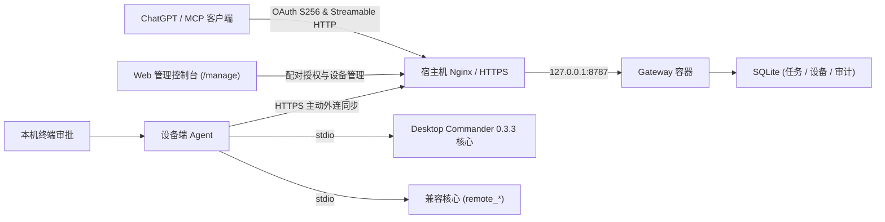

# 客户端复用与系统架构

本文档说明 **Remote.Command** 的系统分层、核心复用方式，以及与官方托管服务的架构对照。关于官方最新稳定发布包的传输路径与 OAuth 公共契约，请参阅 [官方架构核对](official-architecture.md) 与 [客户端分析](client-analysis.md)。

---

## 整体架构

### 本地核心复用基线

- **上游基线**：[@wonderwhy-er/desktop-commander@0.3.3](https://www.npmjs.com/package/@wonderwhy-er/desktop-commander/v/0.3.3)（Git 修订 `bce370e9395f5bc74eda34913e5ae1dee48df8f8`）。
- **核心适配**：自建 Agent 通过 `src/dc-core.ts` 启动完整 MIT 本地核心，使用本地运行时适配器替代了官方遥测、发布开关、远程反馈上报和欢迎页；配置与历史写入设备自己的私有状态目录。
- **原生与兼容并存**：默认导出 `tools/list` 中的 25 个原生工具与 2 个 MCP App 资源，完整保留文本、图片、`structuredContent` 与 `_meta`；同时保留 `vendor/desktop-commander` 提供的第一版 `remote_*` 兼容工具。
- **许可与可追溯性**：[MIT 许可证](../vendor/desktop-commander-full/LICENSE) · [本地修改说明](../vendor/desktop-commander-full/NOTICE.md) · [文件来源与哈希清单](../vendor/desktop-commander-full/manifest.json) · [再生成脚本](../scripts/prepare-dc-core.mjs)

---

## 分层职责设计

| 分层 | 核心职责与实现细节 |
| --- | --- |
| **MCP Gateway** | 提供 OAuth S256、设备选择、任务队列与结果查询接口。Docker 镜像仅打包 Gateway 运行时依赖、工具 Schema 与管理页面。 |
| **设备连接与配对** | 支持自建 S256 短码浏览器配对与 10 分钟一次性邀请码；设备凭证由 Agent 生成，服务端仅保存摘要；临时会话凭证仅驻留内存。 |
| **本地执行器** | Agent 在 stdio 工具发现通过后才上报在线；执行器异常退出后自动退避重连，恢复期间 Gateway 暂停派发任务。 |
| **状态与一致性** | SQLite 持久化派发、审批、执行与终态；同一 Agent 通过启动 ID 与任务 ID 去重并重传终态直到确认；实例替换或正常退出时，未确认任务标为 `interrupted`。 |
| **安全边界** | 服务端配对权限与本机配置取交集，敏感操作需设备终端逐次审批；文件工具在解析路径后校验 `workspace` 与 `allowedDirectories` 上限；已获批命令继承运行 Agent 的 OS 用户权限。 |
| **进程与队列配额** | 原生进程工具采用 PID 与持久会话语义（终止进程需显式调用 `force_terminate` 或 `kill_process`，取消 MCP 请求仅撤回等待/排队）。每台设备上限为 **4 个并发任务**、**64 个排队任务**，结果默认保留 **7 天**。 |
| **诊断与部署** | 设备主动发起 HTTPS 连接。宿主机 Nginx 负责域名与 TLS，Gateway 容器仅在宿主机回环地址发布端口。诊断 ZIP 使用受控字段与有界日志。 |
| **npm 独立客户端** | 独立 `.tgz` 提供 `remote` 子命令及同名启动、会话、后台服务与诊断参数，内置 MIT 本地核心、运行依赖清单与锁文件。 |

---

## 与官方 Remote 服务对照

| 能力维度 | 官方 Remote 服务 | Remote.Command 自建实现 |
| --- | --- | --- |
| **配对与生命周期** | 终端启动、浏览器短码配对、持久身份/临时会话、退出 | 自建 Gateway 提供配对授权，CLI 保留主要会话与诊断参数 |
| **工具与 MCP Apps** | 25 个本地工具 + 2 个核心资源 | 完整复用 25 个本地工具与 2 个核心资源（具体 UI 渲染取决于宿主客户端支持） |
| **跨设备历史与查询** | 后台调用记录与 `call_id` 异步查询 | 支持 `list_remote_tool_calls` 与 `get_tool_result`，敏感调用仍需设备端审批 |
| **调用预览与审阅** | `review_device_call` 审阅未执行调用 | 返回原始参数与标准 MCP App（支持工具桥接的宿主可由用户触发执行；已被宿主拦截的仅显示说明） |
| **控制台与权限** | 官方仪表盘管理设备与授权 | 独立 `/manage` 控制台，支持设备核对、状态筛选、结果查看、批量撤销与操作审计 |
| **账号、配额与诊断** | 官方账号体系、订阅配额与遥测上报 | 无累计调用次数限制；诊断包仅在本地生成，完全由个人掌控 |
| **待实测项** | — | 真实 ChatGPT 网页账号安装与聊天内 MCP App 渲染、Windows 实机端到端验收 |
