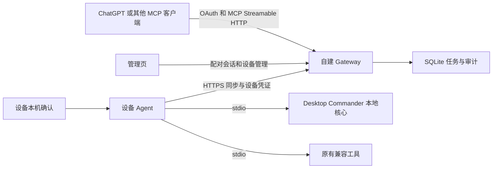

# 客户端复用与架构

官方最新稳定发布包的传输路径、OAuth 公共契约与自建差异见 [官方架构核对](official-architecture.md)。本页记录自建工程和原先复用的本地核心基线。

以官方 npm 0.3.3 发布包为基线，源码修订为 `bce370e9395f5bc74eda34913e5ae1dee48df8f8`。自建 Agent 使用 `src/dc-core.ts` 启动完整 MIT 本地核心。原生工具名和入参由实际 `tools/list` 导出，Gateway 保留文本、图片、MCP 结构化结果和 MCP App 资源。[客户端分析](client-analysis.md) · [上游版本](https://www.npmjs.com/package/@wonderwhy-er/desktop-commander/v/0.3.3) · [MIT 许可证](../vendor/desktop-commander-full/LICENSE) · [文件来源和修改哈希](../vendor/desktop-commander-full/manifest.json)

| 层 | 行为 |
| --- | --- |
| MCP Gateway | OAuth S256、设备选择、任务队列和 MCP 结果查询。Docker 镜像仅安装 Gateway 的 JS 依赖并随附工具 schema 和管理页。 |
| 设备连接 | 自建 S256 短码配对或一次性邀请。设备凭证由 Agent 生成，服务端保存摘要。临时设备凭证只在当前 Agent 进程中持有。 |
| 执行器 | Agent 在 stdio 工具发现通过后才报告在线。执行器退出后退避重连，恢复期间 Gateway 不派发新任务。默认使用 25 个原生工具，并保留最初的 `remote_*` 接口。 |
| 状态 | SQLite 保存派发、批准、执行与最终结果。同一 Agent 用启动 ID 和任务 ID 去重，重传最终结果直到 Gateway 确认。Agent 换实例或正常退出时，未确认结束的已派发任务标记为中断。 |
| 本机边界 | 本机配置和网关配对同时限制能力，敏感任务须由设备逐次批准。原生文件工具在解析路径后应用工作区上限和已保存的 `allowedDirectories`。获批命令继承设备用户权限。 |
| 诊断与部署 | 设备只出站连接，Caddy 为生产 HTTPS 入口。Gateway 使用本地 SQLite 卷。诊断 ZIP 使用受控字段和有界事件日志。 |
| npm 客户端 | 独立 `.tgz` 提供 `remote` 子命令和官方同名的启动、会话及诊断参数。首次运行填写自建 Gateway 地址并在浏览器完成配对。打包包含 MIT 本地核心、运行依赖清单及锁文件。 |

完整核心用运行适配替代了官方遥测、发布开关、反馈上报和欢迎页，配置与历史写入设备自己的私有状态目录。Office/图片/PDF 解析使用真实本地依赖，Markdown 转 PDF 使用配置的 Chrome 或 Chromium。原有兼容核心保存在 `vendor/desktop-commander`，继续提供第一版的文本操作和搜索。[完整核心改动](../vendor/desktop-commander-full/NOTICE.md) · [再生成脚本](../scripts/prepare-dc-core.mjs)

原生进程工具采用 PID 和会话语义。取消任务用于撤回排队工作、取消确认或停止等待 MCP 响应。已经启动的原生终端进程通过 `force_terminate` 或 `kill_process` 停止。直接文件工具的路径校验依赖可信本地工作区，不能替代操作系统沙箱。每设备四个活动任务和 64 个排队任务，结果保留七天。

## 官方 Remote 使用方式对照

| 使用路径 | Remote.Command |
| --- | --- |
| 终端启动、浏览器短码配对、保存身份、临时会话、退出 | 自建 Gateway 提供配对授权。`remote` 子命令保留主要会话参数。 |
| 文件、进程、搜索、代码编辑和核心界面 | 复用实际发布的 25 个本地工具及两个核心资源。宿主决定是否以及如何显示 MCP App。 |
| 跨设备历史和结果 | `list_remote_tool_calls` 查询 0.3.0 起记录的后台调用。结果可用 `call_id` 查询，敏感任务仍在设备端审批。 |
| 审阅未执行的工具 | `review_device_call` 返回原始参数及标准 MCP App。支持工具桥接的宿主可处理用户主动触发的普通 MCP 调用。宿主已拦截的调用仅显示说明。 |
| 管理与授权 | 独立控制台支持核对设备、按状态筛选、查看结果及操作审计。设备密钥和 Gateway 认证由部署者控制。 |
| 诊断、官方账号和托管配额 | 自建客户端诊断保存在本机。官方账户、订阅、诊断上传和运营后台由官方服务提供。 |
| 待实测 | 真实 ChatGPT 网页账号安装和聊天内渲染，以及 Windows 实机。 |
