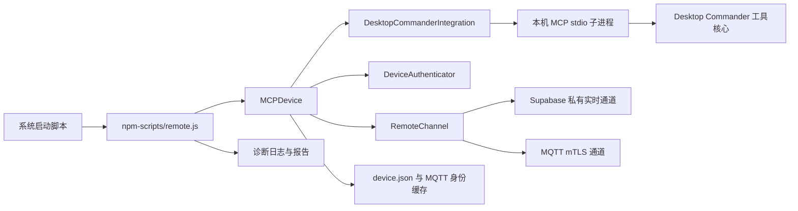

# Desktop Commander Remote 客户端分析

当前稳定版和托管架构的核对移至 [官方架构核对](official-architecture.md)。其中的隔离探针验证了 MQTT 收件不触发任务执行，实际执行仍由私有 Broadcast 引导。

审查日期为 2026-11-17。本报告以实际发布的设备客户端为主要对象。目标版本为 `@wonderwhy-er/desktop-commander@0.3.3`，npm registry 的 `gitHead` 为 `bce370e9395f5bc74eda34913e5ae1dee48df8f8`。发布包 SHA-256 为 `42390020cceb1cdfa537506fcd70f61eae10ab226c098403f1c5a77c350b07b3`。本次使用已解包副本 `/private/tmp/remote-command-audit-npm` 检查发货 JavaScript、声明文件和配置。上游 MIT 许可证允许复用这些模块，交付时需保留版权和许可文本。[上游项目](https://github.com/wonderwhy-er/DesktopCommanderMCP) · [npm 0.3.3](https://www.npmjs.com/package/@wonderwhy-er/desktop-commander/v/0.3.3)

## 证据与覆盖

| 标识 | 已取得的证据 | 覆盖与限制 |
| --- | --- | --- |
| C1 | npm 0.3.3 的 `dist/remote-device`、`dist/npm-scripts/remote.js`、`dist/server.js`、`dist/tools/schemas.js` | 已静态读取实际发货代码。静态读取能证明代码路径存在，运行结果仍需执行验证。 |
| C2 | REA `ev_ba4f23db36f955185f9b432e23d20e7652a0a6929718f59d04976533cb78c773` | 设备端 31 个 JavaScript 文件的已发布工件分析。文件清单完整，语义图覆盖部分路径。 |
| C3 | REA `ev_035abd678924e7f821a38420becb7fe70cda29eb75f0db62a3cbb6eb19d8d0a1` | 完整发行目录静态分析。296 个 JavaScript 文件成功解析，较大关系图受到预算约束，存在未决关系。摘要为 `ev_57e7f1efb694ab7db128594d2903b7f5875b4d31077e489871729ed554eef7b6`。 |
| C4 | 当前会话安装的官方 `Remote Desktop Commander` connector 工具元数据 | 可观察到 30 个公开 Remote 工具的名称、描述和 JSON schema。未调用这些工具访问用户设备。工具清单会随官方更新。 |
| C5 | `scripts/remote/README.md` 和 macOS/Linux/Windows 启动脚本 | 已读取公开 `main` 版本。指定 gitHead 的 raw 下载本次未成功，启动脚本没有冒充为 0.3.3 包内文件。 |

下文的文件行号均指 C1 实际发货 JavaScript。C2 和 C3 保留的静态图未建立官方生产服务的行为等价性。官方服务端的账户系统、配额实现、数据库策略及 Web UI 私有接口需要独立证据，不能从设备端代码推出完整实现。

## 客户端组成

`npm-scripts/remote.js` 是用户输入 `desktop-commander remote` 的主要入口。它处理命令行选项、终端时间戳、日志和可选防休眠，再构造 `MCPDevice`。`MCPDevice.start()` 负责本地执行器、登录恢复、设备注册和远端连通性。`DesktopCommanderIntegration` 使用 MCP SDK 创建 stdio 子进程，透传实际工具名及参数。Remote 客户端的文件、进程和搜索能力来自该子进程的本地核心。对应入口在 `dist/npm-scripts/remote.js:20`、`dist/remote-device/device.js:240` 和 `dist/remote-device/desktop-commander-integration.js:74`。

## 启动、配对和身份生命周期

| 客户端行为 | 发货代码中的实现 | 独立工程需要复刻的行为 |
| --- | --- | --- |
| 检测系统、Node 和 npm | 公开启动脚本在当前 PATH 和标准安装目录查找 Node，验证 Node 至少为 22.12。缺少运行时会读取用户确认，下载 Node 24 校验清单和匹配架构的安装包 | 提供 Windows、macOS、Linux 启动方式，保留用户现有 Node。自动安装可作为明确可选步骤 |
| 普通用户运行客户端 | 仅 Node 安装使用系统提权，后续 `npx --yes ... remote` 在原用户下执行 | Agent 的工具执行继承明确的本机用户身份 |
| 启动选项 | `remote.js:22` 公开 `--logout`、`--report`、`--no-upload`、`--no-persist-session`、`--disable-no-sleep`、`--debug` 和帮助 | 等价 CLI 应覆盖退出、诊断、本地日志、会话行为与帮助 |
| 设备配对 | `device-authenticator.js:15` 生成 32 字节随机 verifier 和 S256 challenge，先启动 device flow，再显示网址和短码，尝试打开浏览器 | 自建配对流程需要短码、确认页面、超时和轮询状态，凭证绑定设备和 Gateway |
| device start | `device-authenticator.js:41` 向 `/device/start` 发送设备名、设备类型、可选原 device ID、固定 client ID 和 PKCE challenge | 自建服务处理等价的设备登记和一次性授权请求 |
| device poll | `device-authenticator.js:101` 按服务器 interval 轮询 `/device/poll`，发送 device code 和 verifier。支持 pending、slow_down、终止拒绝、过期和暂时网络错误 | 失败状态须明确区分，并在终止拒绝后结束等待 |
| 恢复登录 | `device.js:409` 读取设备 ID 与保存 session，检查设备仍存在。`remote-utils.js:71` 比较原服务端和认证端的绑定 | 恢复只应用于相同 Gateway。已撤销设备须重新配对 |
| 刷新凭证 | `device.js:159` 注册 session refresh 回调。`remote-channel.js:85` 配置 45 分钟刷新。`device.js:500` 串行保存已轮换凭证并检查文件是否已被 logout 删除或替换 | 凭证写入需原子化，旧进程不得复活被撤销的身份 |
| 退出登录 | `device.js:53` 先请求后端撤销，成功确认后删除 device.json 和 MQTT 证书缓存。失败会保留凭证供重试 | 自建 Agent 应提供退出/撤销并处理失败可重试 |
| 避免混用官方服务 | `remote-utils.js:37` 将官方客户端的远端域名限制为 Desktop Commander 域名和指定本地开发域 | 自建版须使用自己的 endpoint 配置与绑定逻辑 |

启动脚本的系统安装细节分别是 macOS `.pkg`、Windows `.msi` 和 Linux 架构对应 archive。它们从校验清单选择包并校验 SHA-256，脚本退出会清理下载目录。`main` 脚本包括安装失败反馈和手动下载指引。对应来源为公开客户端启动脚本。[启动脚本说明](https://raw.githubusercontent.com/wonderwhy-er/DesktopCommanderMCP/main/scripts/remote/README.md) · [macOS](https://raw.githubusercontent.com/wonderwhy-er/DesktopCommanderMCP/main/scripts/remote/remote-macos.sh) · [Linux](https://raw.githubusercontent.com/wonderwhy-er/DesktopCommanderMCP/main/scripts/remote/remote-linux.sh) · [Windows](https://raw.githubusercontent.com/wonderwhy-er/DesktopCommanderMCP/main/scripts/remote/remote-windows.ps1)

## 本地 MCP 子进程与故障恢复

`desktop-commander-integration.js:230` 解析启动配置，`initialize():74` 构造 `StdioClientTransport` 并传入 `DC_REMOTE_DEVICE=true`，其余设备环境会进入本地 MCP。客户端先完成 `initialize`，再调用 `listTools` 验证执行器确实能处理请求，之后才报告 ready。`callClientTool():267` 保留工具名与参数，追加 `_meta.remote=true`，单次代理等待上限为 30 分 30 秒。

本地执行器死亡由 MCP Client 的 `onclose` 触发。`handleLocalDisconnect():62` 撤回 ready，`MCPDevice.handleLocalMcpLoss():597` 把设备转为不可达并循环尝试恢复。`ensureReady():171` 和 `restartChild():195` 合并同时发生的重启并使用退避，最长五秒。普通协议错误仅记日志，避免把可恢复错误误当成子进程退出。

独立 Agent 应把“设备在线”绑定到远端连接和本地 MCP 健康状态。运行中的任务在子进程退出时需要确定的终止或中断状态，随后自动恢复执行器，并用真实 `listTools` 或读操作证实恢复成功。

## 远端传输与任务交付

| 代码 | 可直接确认的行为 | 自建版可保留的语义 |
| --- | --- | --- |
| `remote-channel.js:541` | 注册设备，保存工具 capabilities，建立私有通道，等通道和设备行都就绪后返回 | 登记设备能力，能力和状态与可执行性同步 |
| `remote-channel.js:1391` | 可达条件同时要求私有通道 joined、通道状态写入成功和本地执行器 ready | 双端健康检查决定是否可选 |
| `remote-channel.js:51` | 五分钟业务心跳。其余 socket 健康检查分别处理重连、75 秒无心跳、30 秒加入僵死和有界恢复 | 主动心跳、重连退避、抖动、故障探测 |
| `remote-channel.js:928` | 重连后查找仍未过期的 pending 请求，每批最多 100 个，并逐个条件认领 | 持久队列和断线补取 |
| `remote-channel.js:1306` | `pending → executing` 的条件更新结合 timeout 检查。数据库写入错误时旧路径允许继续 | 自建版使用同一事务原子认领，明确处理执行权 |
| `device.js:642` | 当前进程记住最近 100 个 call ID 防重复 | 每个任务只执行一次，重复通知只触发查状态 |
| `device.js:651` | 检查目标 device ID，接收工具及 metadata，透传本地 MCP，保存完成或失败 | 校验设备归属，保留调用关联 ID 与完整 MCP 返回 |
| `remote-channel.js:1330` | 保存 rich MCP result，递归剔除 NUL 以满足 PostgreSQL 存储约束，写入失败转为明确失败状态 | 保留 text/image/resource/structuredContent，失败不能表现为成功 |
| `remote-channel.js:1380` | 结果已存储后，再尽力发送 MQTT 结果通知，最多三次 | 结果存储为真相来源，通知可重试 |
| `device.js:692` | `ping` 返回时间戳，`shutdown` 在回应后关闭 Remote Agent | 提供设备诊断和明确的远端断开动作 |

MQTT 属于客户端发货传输实现。`mqtt/mqtt-enrollment.js:81` 生成或恢复 RSA 身份，用 CSR 向已认证后端注册，私钥保留本地。缓存校验证书有效期、对应私钥、设备和 broker。`mqtt/mqtt-transport.js:7` 强制 `mqtts`、服务器证书验证、设备证书和 key。每设备使用确定的 topic，连接与 QoS 1 订阅确认成功后才标 ready，重连重新订阅。消息只包含 call/user/device 标识，实际工具参数从任务存储读取。`publishResult():205` 向原 Gateway instance 对应 topic 通知 call ID，等待至多五秒确认。

沿用原请求的自建约束，独立实现可用 HTTPS、WebSocket 或长轮询达到主动出站、持久请求、去重、结果查询和恢复的功能目标。直接启动官方 Remote 客户端会引入官方 OAuth、Supabase 和 MQTT 注册依赖，因此实际复用点应放在 MIT 本地工具核心和设备端通用生命周期逻辑。

## 功能工具清单

0.3.3 本地 MCP `tools/list` 定义了 25 个工具。`track_ui_event` 另外列在参数映射和 dispatcher 内。以下语义直接来自 `dist/tools/schemas.js` 及 `dist/server.js`。

| 工具 | 官方客户端代理到的能力 |
| --- | --- |
| `get_config` | 查看 blockedCommands、defaultShell、allowedDirectories、读写行数、telemetry、client 历史等 |
| `set_config_value` | 设置单项配置，值支持字符串、数字、布尔、字符串数组与 null |
| `read_file` | 本地或 URL，正负行偏移、长度、Excel sheet/range、格式 options，返回文本或 rich 内容 |
| `read_multiple_files` | 并发读取多个文件，单文件失败独立返回 |
| `write_file` | 重写或 append，文件格式工厂处理文本及支持的文档类型 |
| `write_pdf` | Markdown 新建，或 insert/delete 页操作，支持 outputPath 与渲染 options |
| `create_directory` | 创建嵌套目录 |
| `list_directory` | 按 depth 递归列目录并控制过多嵌套项 |
| `move_file` | 同时支持改名与跨目录移动 |
| `start_search` | files/content、regex/literal、filePattern、大小写、hidden、context、maxResults、超时和提前结束 |
| `get_more_search_results` | 会话结果分页和负 offset 尾部读取 |
| `stop_search` | 停止执行中的搜索并保留最终结果 |
| `list_searches` | 查询搜索会话状态和运行时间 |
| `get_file_info` | 文件类型、尺寸、时间、权限、文本行数及文档元数据 |
| `edit_block` | 唯一或指定次数替换，结构化文件 range/content，模糊匹配提示与行尾处理 |
| `start_process` | shell command、选择 shell、等待上限、智能进程状态检测、普通命令和 REPL |
| `read_process_output` | 新输出、绝对行位置、尾部读取、长度和等待上限 |
| `interact_with_process` | 向 stdin 写入，等待提示符或有界返回 |
| `force_terminate` | 终止受管会话及其进程树 |
| `list_sessions` | 活动终端会话、PID、blocked 状态和运行时间 |
| `list_processes` | 系统进程列表，Windows tasklist 与 POSIX ps |
| `kill_process` | 正 PID 终止，受管进程会终止子树 |
| `get_usage_stats` | 本地工具调用统计、成功失败及性能 |
| `get_recent_tool_calls` | 可过滤的本地调用历史，支持 maxResults、toolName、since |
| `give_feedback_to_desktop_commander` | 打开人工反馈入口 |

文件核心支持 Excel、PDF、DOCX 和图片，依赖关系来自 `dist/utils/files/factory.js`、`dist/tools/pdf` 及 `package.json`。PDF Markdown 渲染涉及浏览器运行时，相关二进制与依赖必须安装后实际测试。`dist/ui/resources.js:8` 提供 `ui://desktop-commander/file-preview` 和 config-editor 两个 `text/html;profile=mcp-app` 资源，工具 `_meta` 关联预览。客户端代理完整 result 的能力不等于已验证 ChatGPT 宿主能展示所有上游 UI。

C4 中官方 Remote 当前公开工具清单另含 `list_devices`、`who_am_i`、`get_tool_result`、`list_remote_tool_calls`、`review_device_call` 和 `shutdown`，同时未公开核心 feedback 工具，总数为 30。`get_tool_result` 与 `list_remote_tool_calls` 用于超过同步等待窗口的远端调用。`review_device_call` 的元数据描述了由宿主阻止的调用审阅面板和 Run/Cancel 操作。宿主侧面板具体实现和可复用 API 仍需另行验证。

## 日志、诊断、开关和关闭

| 行为 | 证据 | 独立客户端实现方向 |
| --- | --- | --- |
| 时间戳和 debug | `remote.js:21`、`:78`，默认隐藏 debug 控制台输出 | 保留状态反馈和可选详细日志 |
| 本地诊断日志 | `diagnostics/device-log.js:18` 限制文件尺寸，`:88` 过滤敏感行，写入前脱敏 | 有界轮转日志，记录连接与工具生命周期，不把凭证写入 |
| 诊断报告 | `diagnostics/report.js:543` 收集版本、OS、安装形态、时钟、网络、设备状态与日志摘要，`:715` 输出 zip 中的 report.txt、report.json 和日志 | 本地导出脱敏诊断包，覆盖自建 Gateway 与 Agent 健康 |
| 诊断上传 | `report.js:730` 默认上传官方配置的诊断服务，`--no-upload` 保存本地 | 自建工程应提供自己控制的导出和提交方式 |
| macOS 防休眠 | `remote.js:96` 可选加载 caffeinate 并监视当前 PID，终止后自动解除 | macOS 可提供 keep-awake 开关，Windows/Linux 需逐平台验证 |
| 发布开关 | `rollouts.js:38` 请求 `/device/rollouts`，每 30 分钟刷新，也接受任务 metadata 更新 | 本地可验证配置或自建 feature flags，更新需保持因果顺序 |
| 关闭 | `device.js:749` 停心跳、退订通道、标离线、等待配置写入、关闭 MCP 子进程，`:196` 的信号处理有五秒强制退出 | 可重复关闭，停止接受新任务，尽量提交终态并释放资源 |

## 官方发布类的受控运行结果

2026-11-18 使用 SHA-256 相符的 0.3.3 npm 发布包运行了两组探针。实际 `DeviceAuthenticator` 在注入的响应下验证了配对 PKCE、等待、限速、临时错误和终止拒绝。实际 `DesktopCommanderIntegration` 通过自己的本地路径解析启动了一个真实的 stdio MCP 测试进程。它在工具发现后才就绪，原样转发了参数、`_meta` 和富媒体结果。工具处理过程中子进程退出时调用失败，并发的下一组调用共享一次重启。主动关闭以后再调用会被拒绝。[认证探针](client-probe-results.json) · [桥接探针](client-bridge-probe-results.json)

探针使用隔离的本机进程和测试数据。它替换了认证网络响应、遥测和全局安装回退，覆盖的是客户端执行逻辑。生产 Supabase、MQTT、账号计费与官方宿主审阅界面属于独立的证据范围。复现命令分别为 `node scripts/probe-official-client.mjs <解包目录>` 与 `node scripts/probe-official-bridge.mjs <解包目录>`。

## 验收与未决项

以下是对发货客户端已确认路径的执行验收要求。静态和受控运行的覆盖见上文。跨平台运行及自建 Agent 验收见 [验收记录](verification.md)。

1. 在隔离目录启动实际 CLI 的 `--help` 和 `--report --no-upload`，检查返回码、报告内容、敏感信息脱敏和报告文件权限。
2. 对真实 `DeviceAuthenticator` 注入自建测试 fetch/open，验证 S256、授权 pending、slow_down、拒绝、过期和浏览器无法打开时的回退网址。
3. 用真实 stdio MCP 测试服务器启动 `DesktopCommanderIntegration`，验证握手后 `listTools`、工具转发 metadata、rich result、子进程死亡、并发恢复和关闭期间禁止重启。
4. 对受控存储/通道验证重复 doorbell、不匹配 device ID、已过期调用、网络断开后补取、结果写入失败和时间偏差。
5. 对自建 Agent 验证 CLI 配对、保存/恢复身份、撤销、断线重连、长任务状态，以及受管 shell 和交互 REPL。
6. 使用 Node、Python 的交互 stdin/stdout，验证 output pagination、negative offset、session list、进程树停止，Windows 与 POSIX 分开执行。
7. 对 Word、Excel、PDF 和图片分别建立真实 fixture。PDF 页面修改和 Markdown 渲染分别执行，明确记录浏览器或图像二进制缺失。
8. 在 Windows、macOS、Linux 检查独立启动、路径、信号、诊断和注销。每项以对应 OS 上的结果记录完成状态。

官方 Remote 服务端的全部行为、当前所有 rollout、账号和付费套餐逻辑、托管服务性能与宿主审阅面板实现仍缺乏完整可执行证据。完整复刻验收应按上述客户端入口、工具、数据格式、连接生命周期和逐平台运行结果分别记录进度。
