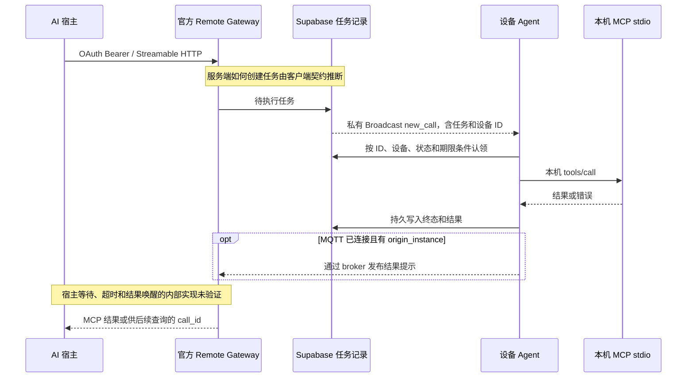

# Desktop Commander Remote 官方架构核对

2026-11-23 再查 npm registry，稳定版 `latest` 指向 `0.3.4`，`alpha` 指向 `0.3.4-alpha.0`。本报告分析稳定版实际发布的客户端，并把托管服务公开接口与客户端推断分别标明。0.3.4 发布包对应 Git 修订 `9a101b17e44577f0baefa4c7120f087881c5cc56`，tarball 的 SHA-256 为 `7e2e219b5f8c595832af6d63fe11e51bccf2623cbad2885c5becd0f000f0010a`。[npm 发布标签](https://registry.npmjs.org/-/package/@wonderwhy-er%2fdesktop-commander/dist-tags) · [官方 Remote 仓库](https://github.com/desktop-commander/remote-desktop-commander)

## 三个独立运行的部分

| 部分 | 已确认的接口和职责 | 证据范围 |
| --- | --- | --- |
| AI 客户端与官方 Gateway | AI 宿主通过 Streamable HTTP 访问 `/mcp`，以 OAuth 获得授权。公开授权发现宣告授权码、刷新、PKCE S256 和动态客户端注册（DCR）。 | 官方托管仓库和公开 OAuth 发现。DCR 仅验证公开元数据，没有向生产环境注册或授权。 |
| 托管任务中继 | 设备访问 Supabase 私有 Realtime Broadcast 和 PostgREST，读取、认领和更新 `mcp_remote_calls` 行。设备连通性写入 `mcp_devices`。 | 从实际客户端的 SDK 调用确认。服务端怎样插入任务、部署 Gateway 和实施租户隔离无法由客户端推出。 |
| 本机 Agent 与工具 | npm 包的 `remote` 子命令运行设备 Agent。它启动本机 Desktop Commander MCP stdio 子进程，转发工具与参数，并保留图片和结构化结果。 | 发布包静态代码、受控 stdio 探针。发布包声明 Node.js ≥22.12.0。 |

官方托管仓库公开安装与集成清单，并说明托管服务实现未开源。MIT 发布包提供本地工具核心和设备端代码。两者的公开边界不同，托管清单版本也独立于 npm 客户端版本。[官方托管说明](https://github.com/desktop-commander/remote-desktop-commander) · [官方服务清单](https://github.com/desktop-commander/remote-desktop-commander/blob/main/server.json) · [OAuth 授权服务器发现](https://mcp.desktopcommander.app/.well-known/oauth-authorization-server) · [OAuth 资源发现](https://mcp.desktopcommander.app/.well-known/oauth-protected-resource/mcp)

公开发现文档中的资源 URI 是 `https://mcp.desktopcommander.app`，对应的 MCP 传输入口是 `/mcp`。发现文档宣告 `/register`，列出 `none` 和 `client_secret_post` 两种令牌端点认证方式，资源作用域包括 `mcp:tools` 与 `desktop:auth`。[OAuth 授权服务器发现](https://mcp.desktopcommander.app/.well-known/oauth-authorization-server) · [OAuth 资源发现](https://mcp.desktopcommander.app/.well-known/oauth-protected-resource/mcp)

## 启动、配对和就绪

1. CLI 解析 `remote` 选项，建立控制台与诊断，再由 `MCPDevice.start()` 初始化本机 stdio 执行器。CLI 启动流程、本地桥接和设备认证模块在 0.3.3 与 0.3.4 间逐字节相同。发货代码位置为 `dist/npm-scripts/remote.js`、`device.js:240–322` 和 `desktop-commander-integration.js:74–165`。
2. 设备读取 Gateway 发布的连接和认证信息，拒绝意外重定向，并将已保存的 session 与认证上下文绑定。没有有效身份时，设备生成 PKCE verifier，通过 `/device/start` 取得短码，打开浏览器确认，再通过 `/device/poll` 取得设备身份和会话。AI 宿主自身的 OAuth 是另一次授权。发货代码位置为 `device.js:409–588`、`device-authenticator.js:15–156` 和 `remote-utils.js`。
3. 会话刷新后，客户端更新 Realtime 鉴权，并在仍持有对应会话时串行持久化轮换后的凭证。撤销或会话失效后停止派发。发布代码中的客户端主动刷新周期为 45 分钟。发货代码位置为 `remote-channel.js:310–438`、`remote-channel.js:1530` 附近。
4. 官方 Agent 的可达性同时要求私有 Broadcast 已加入、可达状态已写入数据库、本机执行器应答。Presence 供仪表盘展示，MQTT 也不参与可达性判定。本机执行器故障时，Agent 先撤下可达状态，恢复后用实际 `listTools` 响应确认就绪。发货代码位置为 `remote-channel.js:1440–1448`、`device.js:597–637` 和 `desktop-commander-integration.js:292–301`。

## 任务投递、认领和结果



**执行由 Broadcast 触发。** `onBroadcastDoorbell` 进入认领路径，`onMqttDoorbell` 在 0.3.4 的发货代码中没有执行逻辑。即使 MQTT 通知带有执行标志，受控探针也没有观察到派发。0.3.4 新增动态 `MQTT_TRANSPORT_ENABLED`，缺少该开关时不启动 MQTT。开启时会进行 mTLS 身份登记、连接和订阅，并可发送结果提示。开关变化以串行操作处理。发货代码位置为 `remote-channel.js:594–738`、`mqtt/mqtt-transport.js:180–259` 和 `rollouts.js:63–116`。[传输探针输出](client-transport-probe-results.json)

**任务表决定认领与补收。** Broadcast 中的通知携带任务和设备 ID，实际参数从任务记录取得。主要路径以条件更新完成 `pending → executing`。请求出现错误时会查询任务状态，只有仍为 `pending` 才尝试重新认领。重连后会扫描至多 100 条未过期的 `pending` 任务，`executing` 任务不在补收范围内。旧的二次认领路径在数据库错误时保留原行为，且设备去重集合只覆盖当前进程最近 100 个 ID。客户端证据无法证明跨进程恰好一次。发货代码位置为 `remote-channel.js:965–1117,1343–1365` 和 `device.js:642–684`。

**写结果先于发送通知。** Rich result 写入之前会清理字符串中的 NUL。写失败时，客户端尝试以仅文本错误写入终态。写入成功且有 `origin_instance` 后，MQTT 可发布结果提醒；QoS 1 的回执只来自 broker。结果更新没有读取受影响任务行的回执，服务端和宿主对结果的最终消费仍缺乏证据。发货代码位置为 `remote-channel.js:1367–1436` 和 `mqtt/mqtt-transport.js:204–259`。[传输探针输出](client-transport-probe-results.json)

## 与 Remote Command MCP 0.4.0 的对照

| 行为 | 官方证据 | 自建 0.4.0 与待补项 |
| --- | --- | --- |
| 宿主接入 | 托管服务公开 DCR，支持 AI 宿主独立授权。 | 当前支持固定 OAuth 客户端与 PKCE。若要做到输入 URL 后自动注册，需要实现并验收受约束的自建 DCR。真实 ChatGPT 帐户仍待端到端检验。 |
| 即时派发与重连 | Broadcast 唤醒，数据库条件认领，有限的 reconnect 补收。MQTT 接收不执行。 | Agent 以主动 HTTPS 同步获得任务，SQLite 事务、启动 ID 和终态确认承接交付语义。空闲时约 700–900 ms 同步一次。是否增加主动推送应按目标延迟和设备规模决定。 |
| 同一任务完成与断线 | 主路径有条件认领，若产生不明 `executing` 则不盲目重做。 | 当前启动实例重发未确认结果。实例替换或备份恢复会把不确定的任务标为中断，禁止自动重放。 |
| 授权、设备状态和管理 | 官方管理页分别展示可达状态与最后连接时间，并支持撤销全部设备。 | 当前支持单台设备撤销和批量撤销 OAuth。`seen` 同时作为可达判定和最后见到时间，离线路径会清零。应单独保留最后成功连接时间，再补充批量设备撤销。 |
| 数据保留 | 官方公开隐私说明将中继内容描述为短时保留，并与遥测分开；确切删除时间和验证证据未公开。 | 终态默认保留七天，审计默认九十天，可以配置。在线备份会保存工具结果。若追求与官方相近的隐私体验，需为结果正文提供独立的保留规则。 |
| 宿主拦截与设备审批 | 官方审阅界面可由用户再发起普通工具调用，OpenAI 仍执行自己的检查。 | 自建版对宿主拦截的调用仅预览。尚未执行且未被拦截的调用可由用户在支持的宿主内发起，敏感操作仍需本机确认。 |
| Agent 持续运行 | 官方操作文档要求保留客户端进程，设备重启后需重新启动客户端。 | 0.4.0 提供三平台用户级后台服务入口。原生服务管理器的完整启停、重启恢复还要分平台验收。 |

[官方设备管理](https://github.com/desktop-commander/remote-desktop-commander/blob/main/docs/SETUP.md) · [官方数据隐私说明](https://desktopcommander.app/help/security-privacy/data-privacy) · [审阅与宿主拦截](https://desktopcommander.app/help/troubleshooting/tool-call-blocked-by-safety-checks) · [重启后的连接提示](https://desktopcommander.app/help/troubleshooting/remote-cant-find-computer) · [自建运维说明](production.md)

0.4.1 已把最后连接时间与在线状态分开保存，控制台支持一次撤销所有设备及待处理配对。Agent 完成任务会立即同步终态，派发仍通过由设备发起的 HTTPS 同步。[版本验证](verification.md#remotecommand-041)

## 可复核的证据

- 0.3.3 → 0.3.4 的公开包比较覆盖各 311 个常规文件。仅 `package.json`、`dist/version.{js,d.ts}`、`dist/remote-device/{remote-channel,rollouts}.{js,d.ts}` 七个文件不同。两个官方包的本机桥接、设备认证、工具和界面文件一致。[0.3.3 客户端分析](client-analysis.md)
- REA 对 0.3.4 的 `dist/remote-device` 解析 31 个 JavaScript 文件，零解析失败。目录 SHA-256 为 `463471b3ab02d4c95219a699137f4f71dced1c7babf84ff12011fae40171e23a`。主证据 `ev_bc9e2f246dd534bb0ae5f235c19bfd2b6ebceb0e6cbbb78f7f0159bb1bb8ef76`，摘要 `ev_ab8aa59195b7d73312552209110da21686ddae99deab20b7e7d6b0d67c8ce7cd`。语法覆盖完整，语义关联有未知项，分支结论辅以逐行阅读和受控执行。
- 传输探针校验 `remote-channel.js` 的 SHA-256，再以隔离替身替换联网、数据库和真实执行边界。通过八项断言，包括 Broadcast 派发、MQTT 收件不派发、会话终止停止派发、MQTT 开关、结果写入次序和失败回退。[探针脚本](../scripts/probe-official-transport.mjs) · [探针输出](client-transport-probe-results.json)
- 对照还使用了公开 OAuth 发现、官方托管仓库和当前 connector 工具 schema；未对官方账户发起授权或访问设备。服务端数据库策略、租户隔离、配额、结果清理作业和生产 rollout 的实时值均未验证。

在已解包的 `0.3.4` npm 发布包上复跑本机探针。

```sh
node scripts/probe-official-client.mjs /path/to/package
node scripts/probe-official-bridge.mjs /path/to/package
node scripts/probe-official-transport.mjs /path/to/package
```
